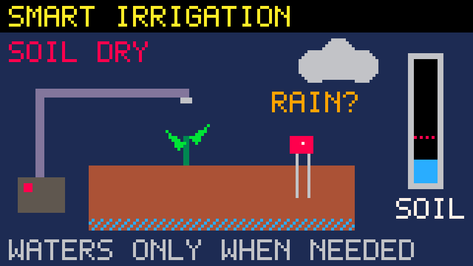
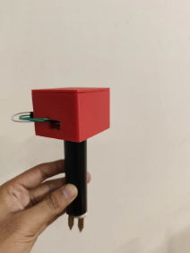
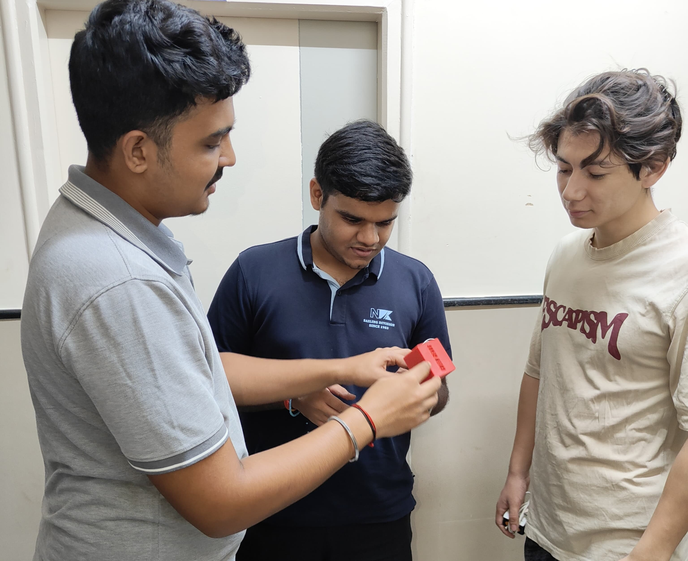
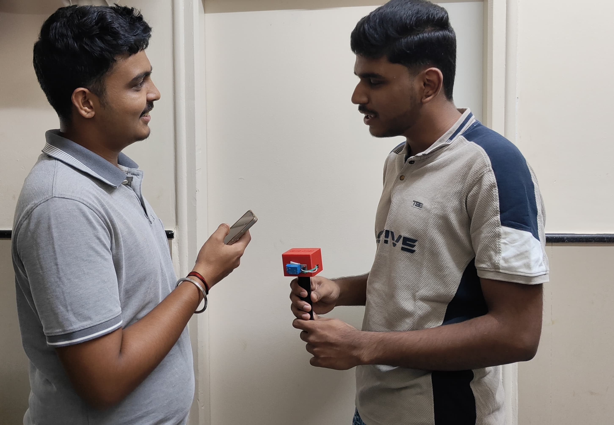
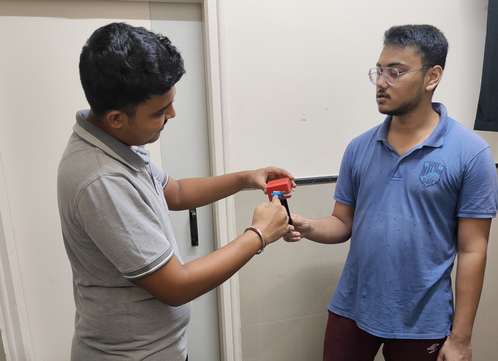

# Cloud-Based Irrigation System

Soil-moisture sensor and weather-API rain check decide when a pump waters, so plants aren't watered when soil is wet or rain is coming.



```
git clone https://github.com/shanthoshkv/Cloud-based-irrigation-system-to-counteract-over-irrigation
```

Nothing to flash or run: this repo is the project archive (report, poster, slides, photos, video). The firmware is not included (see Known gap below).

 

3D-printed probe housing and the full wiring: NodeMCU/ESP32, relay, FC-28 probe, pump, with Blynk and the weather API on the Wi-Fi side.

## What this repo is

This is the deliverables archive for an RVCE Design Thinking Lab project (AS247DL/ME247DL, Team Hypernova, submitted 10 June 2025), not a source code repo. It holds the report, poster, presentation, and photo/video documentation of the hardware prototype. The ESP32/Arduino firmware and Blynk dashboard configuration described in the report are not included here.

## The idea

A capacitive soil-moisture probe reads the ground. If moisture is below threshold and OpenWeatherMap says no rain in the next 24 hours, a relay switches a pump on. If rain is forecast, the system waits. If the forecast is wrong and moisture keeps dropping past a second, lower threshold, the pump turns on anyway, so a bad forecast can't leave a plant dry. Everything reports to a Blynk dashboard with a manual pump override.

The survey behind this (~70 responses): 85.7% of respondents still water by hand, and 75.4% wanted a semi-automatic system they could still override, not a fully closed loop. That's why the manual switch exists on the dashboard rather than the loop running unattended.

### Control logic

```
read soil moisture
        |
moisture < threshold_low?  --no--> pump stays off, keep polling
        | yes
        v
check OpenWeatherMap: rain in next 24h?
        |                       |
       yes                      no
        |                       |
 wait, re-poll moisture    pump ON, report to Blynk
        |
moisture < threshold_failsafe (lower than threshold_low)?
        |
       yes --> pump ON anyway (forecast override, plant doesn't die on a bad forecast)
        |
        no --> keep waiting
```

The failsafe threshold exists specifically because a wrong "no rain" forecast that gets acted on (wait, don't water) is the failure mode that matters most, a plant that goes too dry while the system is waiting on a forecast that never delivers. The second, lower threshold catches that case regardless of what the weather API said.

## Hardware

| Component | Role |
|---|---|
| ESP32 / NodeMCU | Controller, Wi-Fi to Blynk and the weather API |
| Capacitive soil probe (FC-28 style) | Moisture sensing |
| Relay module + pump | Actuation |
| OpenWeatherMap API | 24h rain forecast |
| Blynk | Dashboard: moisture, rain probability, pump on/off, temperature, manual override |
| 3D-printed enclosure (SolidWorks) | Houses the probe and electronics, designed to push into soil |

## Project milestones

  

Review 1 through 3: concept sketch to working prototype, in order.

  

## Documentation

- [`docs/DTL Report.pdf`](docs/DTL%20Report.pdf) — full project report
- [`docs/DTL Presentation.pdf`](docs/DTL%20Presentation.pdf) / `.pptx` — presentation deck
- [`docs/DTL Poster.pdf`](docs/DTL%20Poster.pdf) — project poster
- [`videos/Video.mp4`](videos/Video.mp4) — prototype demo

## What was tested

The report's target was at least 30% less water than a fixed-schedule timer. Small-scale testing with users and gardeners confirmed water savings, less manual labor, and fewer irrigation cycles ahead of rain, but no single farm-scale percentage was published, so none is claimed here beyond what's in the report.

## Known gap

The firmware (ESP32 sketch) and Blynk app configuration aren't in this repo, only the hardware design, documentation, and photos/video. If you want to reproduce the control logic, the report describes the threshold/forecast/failsafe decision logic in enough detail to reimplement it, but there's no code to pull from here directly.

## Next steps (from the report)

- Mobile-first UI and SMS fallback for feature phones
- Offline/edge decision-making for weak rural connectivity
- NPK and pH sensing alongside moisture
- LoRaWAN/GSM as an alternative to Wi-Fi-only, with solar for off-grid beds

## References

Full write-up: [`irrigation.html`](https://aboutkvs.vercel.app/irrigation.html) on the portfolio site.
